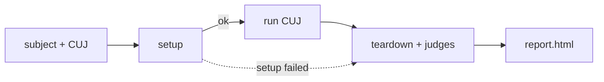

Michelin is an eval harness for AI agents and other programs, driven by LLMs. You describe **critical user journeys (CUJs)** in plain words: what to do and what should be true afterwards. LLMs set the program under test (the **subject**) up, carry out each journey, tear it down, and then a panel of LLM judges scores every expectation against the recorded evidence. Each run leaves `.runs/<runid>/report.html`.

Every suite should ship a **must-fail control**: a CUJ the subject handles correctly but whose expectations are deliberately wrong. A healthy judge panel scores it `passed 0/n`. If a control ever passes, the judges are rubber-stamping and the rest of that run can't be trusted.



## Quickstart

Needs Node 22.18+ (runs `.ts` directly, no build step), `python3`, and the [`claude` CLI](https://docs.anthropic.com/en/docs/claude-code) logged in. Live runs make real model calls.

```sh
npm install        # one runtime dependency (yaml), plus the lint tools; also turns on the pre-commit hook
npm test           # unit tests: no LLM, about 1 s
npm run lint       # tsc + eslint + prettier
node src/run/runner.ts subjects/toy subjects/toy/cujs/toy/
```

The toy subject is a few lines of Python that answer every question with "USA". The run ends with:

```
PASS  toy-country  passed 2/2  (done)
FAIL  toy-name     passed 0/1  (done)
total: 1/2 CUJs passed
```

`toy-name` expects "Alice", so the judges must fail it: that is the must-fail control. Optional: `npm link` puts `michelin` on your PATH (set `npm config set prefix ~/.local` first).

## A real agent: Aider

`subjects/aider` evaluates [Aider](https://aider.chat), the open-source AI pair programmer, on three CUJs: make a failing unit test pass, answer a question about a two-file repo without editing it, and a must-fail control. Aider runs through `uvx` ([uv](https://docs.astral.sh/uv/)), so nothing is installed globally. It needs a model of its own:

```sh
ollama pull qwen2.5-coder:7b && export AIDER_MODEL=ollama_chat/qwen2.5-coder:7b   # free and local
node src/run/runner.ts subjects/aider subjects/aider/cujs/aider/
```

A healthy run ends `total: 2/3 CUJs passed`; the one FAIL is `aider-fail_control`. Results from a real run are in `subjects/aider/RESULTS.md`.

## Concepts

- A **subject** is a folder of plain markdown: `setup.md` (start it, print what later steps need), `howtorun.md` (how to talk to it) and `teardown.md` (stop it and delete what it made). It may add `.sh`/`.py` helpers.
- A **CUJ** is a yaml file with `instruction`, `timeout_s`, `expectations`, an optional `story` (a note for humans) and an optional `given` (state seeded before the CUJ). CUJs live in their subject, `subjects/<name>/cujs/`. Its id is its path under the last `cujs/`, dashed (`aider-fix_test`).
- Four roles, each a `claude -p` call: the **constructor** runs setup, the **executor** carries out the CUJ and records evidence, the **destructor** runs teardown, and the **judges** score each expectation from the evidence alone. `settings.json` picks the model per role; `--settings <file>` overrides it.
- A CUJ argument may be a folder: every `*.yaml` directly in it runs, each on a fresh start. Files listed one by one share one run. Only one michelin runs per machine at a time (`/tmp/michelin/run.lock`).
- Test subjects for the unit and integration tests are in `test/fixtures/subjects/`.

## Subjects outside this repo

Keep your own subjects in a repo of their own and point `MICHELIN_SUBJECTS` at it (colon-separated, like `PATH`). A subject, CUJ or settings path that doesn't exist as given is looked up there:

```sh
export MICHELIN_SUBJECTS=~/my-subjects
michelin my-app my-app/cujs/smoke/ --settings settings/my-app.json
```

## Write your own subject

1. Make `subjects/<name>/` with `setup.md`, `howtorun.md` and `teardown.md`. Have setup print the handles later steps need and keep everything it creates in the scratch folder it is given.
2. Write CUJs in `subjects/<name>/cujs/`. Make each expectation something a judge can check from recorded output alone.
3. Add a must-fail control.
4. `node src/run/runner.ts subjects/<name> subjects/<name>/cujs/`

## Development

`src/run/` runner and CUJ loading · `src/llm/` claude calls and judges · `src/report/` the HTML report. The pre-commit hook runs lint, unit tests, then a `claude -p` review of the diff (`SKIP_REVIEW=1` skips the review; `RUN_INTEGRATION=1` adds integration tests). Code rules: `CLAUDE.md`.

## License

MIT. See `LICENSE`.
