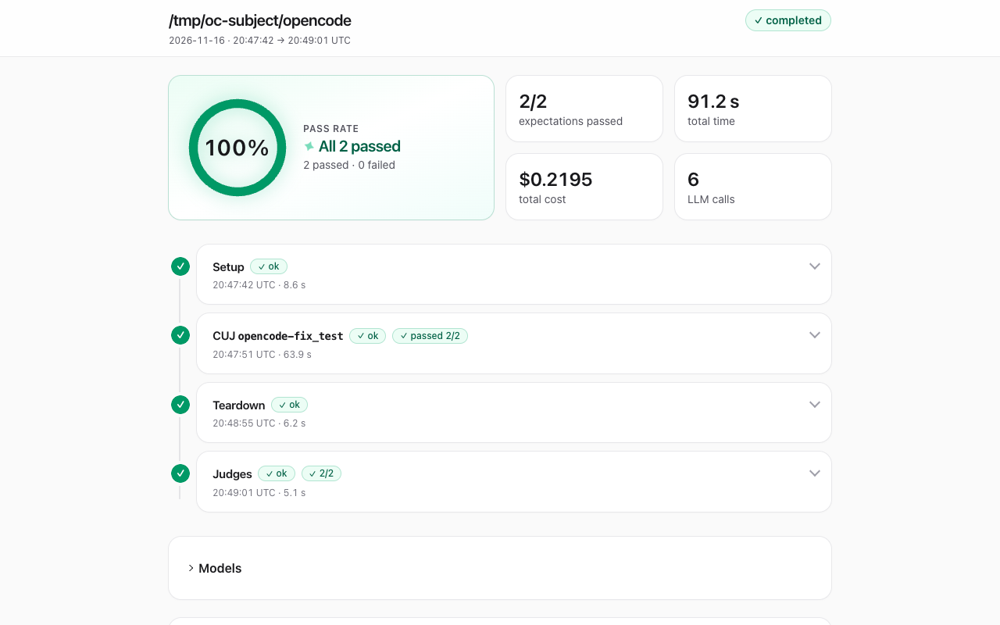

**Eval harness for AI agents: describe user journeys in plain words, LLM judges score the evidence.**

[](LICENSE) [](https://nodejs.org)



## Why

- **Journeys, not unit asserts.** A CUJ is a few lines of yaml: what a user does and what should be true afterwards. An LLM sets your agent up, drives it, and tears it down.
- **Judges see evidence, not vibes.** Judges score each expectation from the recorded steps alone; extra judges join and vote when the first one fails or flips.
- **Any metric you care about.** A subject's how-to-run can name any metric (cost, tokens, steps) for the executor to record; `michelin compare` shows them as columns beside wall time, and judges never see them.
- **Trust checks built in.** Every suite ships a must-fail control. If it ever passes, the judges are rubber-stamping.

## Quickstart

Needs Node 22.18+ and the [`claude` CLI](https://docs.anthropic.com/en/docs/claude-code), logged in. Runs make real model calls.

```sh
npx michelin-eval init && npx michelin-eval run
```

`init` writes `michelin.json` and a sample subject; `run` sets it up, runs its CUJs, and leaves `.runs/<runid>/report.html`. Flags `--model`, `--judges` and `--runs` override `michelin.json`, which overrides the built-in defaults.

## A real result: OpenCode

[OpenCode](https://opencode.ai) on Gemma 4 26B (local Ollama), one run per CUJ (n=1), Sonnet 5.5 executor, three judges (Opus 5.5, Sonnet 5.5, Fable 5.2):

| CUJ                     | Result | Expectations | Judge votes |
| ----------------------- | ------ | ------------ | ----------- |
| `opencode-fix_test`     | PASS   | 2/2          | 3/3, 3/3    |
| `opencode-ask_repo`     | PASS   | 2/2          | 3/3, 3/3    |
| `opencode-fail_control` | FAIL   | 0/2          | 0/3, 0/3    |

The control failing is the healthy outcome. Details: [RESULTS.md](subjects/opencode/RESULTS.md).

## Docs

- [Concepts and settings](docs/concepts.md)
- [Write a subject](docs/write-a-subject.md)
- [Subjects outside this repo](docs/external-subjects.md)
- [Evaluate OpenCode](docs/opencode.md)
- [Contributing](CONTRIBUTING.md)

MIT licensed.
