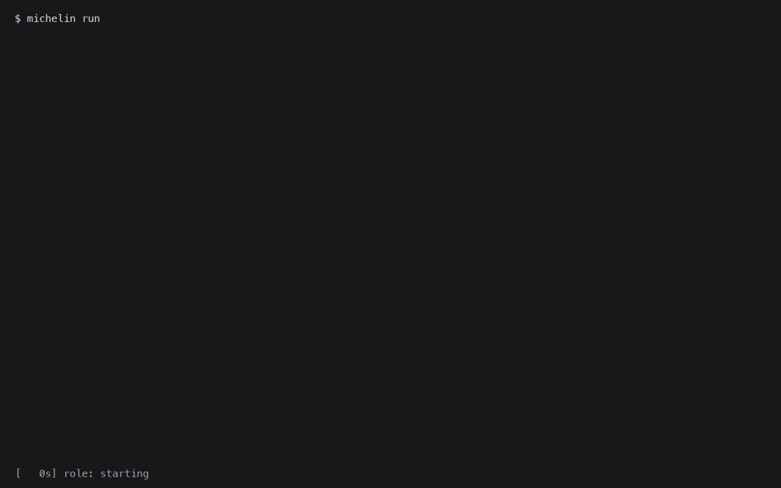

# Michelin

**Michelin evaluates a whole agent system on real user journeys: you write what a user does and what should be true afterwards, an LLM drives your agent through it, and blind LLM judges score the recorded evidence.**

Requires Claude Code (`claude` CLI, logged in).

[](LICENSE) [](https://nodejs.org)



**Evaluate one agent**


**Compare two**


OpenCode on Qwen 3.8 27B vs Gemma 4 26B, five SWE-bench Lite tasks, judged blind to the tests: [results](subjects/opencode/RESULTS.md), [reproduce it](subjects/opencode/README.md).

**[Results page](https://krishansubudhi.github.io/michelin/):** every published run as a sortable leaderboard, built from [`results/`](results); add your own by pull request.

**[Scoreboard](docs/scoreboard.md):** Claude Code, Antigravity and OpenCode on the same 11 CUJs, with the commands to rerun any row or add your own.

## Why it is different

- **Whole systems, real journeys.** A CUJ is a few lines of yaml: what a user does and what should be true afterwards. No harness code inside your agent.
- **Must-fail controls.** Every suite ships a case whose expectations are wrong on purpose. If it passes, the judges are rubber-stamping.
- **Blind judges.** They score the recorded evidence alone. `michelin compare` hides names and models and asks in both orders.

## Quickstart

Needs Node 22.18+, `python3` and the [`claude` CLI](https://docs.anthropic.com/en/docs/claude-code), logged in. Every role is a `claude -p` call with `bypassPermissions`: run subjects you don't trust in a sandbox or a VM.

```sh
npm install -g michelin-eval
mkdir my-evals && cd my-evals
michelin init     # michelin.json and the toy subject
michelin run      # about a minute
```

```
PASS  toy-country  passed 2/2  (done)
FAIL  toy-name     passed 0/1  (done)
total: 1/2 CUJs passed
```

`toy-name` is the must-fail control, so that FAIL is the healthy result. The report is `.runs/<runid>/<cuj-id>/report.html`.

## Where to go next

- **Write your own subject and CUJs, run them, fix failures:** [the skill](skills/michelin/SKILL.md), one plain markdown file. Any coding agent: tell it to read `$(npm root -g)/michelin-eval/skills/michelin/SKILL.md` first. Claude Code can load it by itself: `mkdir -p ~/.claude/skills && cp -r "$(npm root -g)/michelin-eval/skills/michelin" ~/.claude/skills/`
- **Keep the agent away from the answers** (`michelin-sandboxed`): [the skill](skills/michelin/SKILL.md#words)
- **Ready-made subjects and quick checks:** `michelin subjects/claude_code cujs/sanity/` (also `subjects/agy`; `p_` cases must pass, `f_` cases must fail)
- **Compare two runs, blind (A/B):** [docs/compare.md](docs/compare.md)
- **How it works, roles, judges:** [docs/concepts.md](docs/concepts.md)
- **Every flag and setting:** [docs/settings.md](docs/settings.md), or `michelin --help`
- **Subjects outside this repo:** [docs/external-subjects.md](docs/external-subjects.md)
- **A real result, OpenCode:** [RESULTS.md](subjects/opencode/RESULTS.md), [how to run it](docs/opencode.md)
- **Contributing:** [CONTRIBUTING.md](CONTRIBUTING.md)

MIT licensed.
