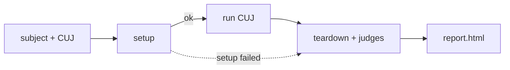

Michelin is an eval harness for AI agents and other programs, driven by LLMs. You describe **critical user journeys (CUJs)** in plain words: what to do and what should be true afterwards. LLMs set the program under test (the **subject**) up, carry out each journey, tear it down, and then a panel of LLM judges scores every expectation against the recorded evidence. Each run leaves `.runs/<runid>/report.html`.

## The parts

- A **subject** is a folder of plain markdown: `setup.md` (start it, print what later steps need), `howtorun.md` (how to talk to it) and `teardown.md` (stop it and delete what it made). It may add `.sh`/`.py` helpers.
- A **CUJ** is a yaml file with `instruction`, `timeout_s`, `expectations`, an optional `story` (a note for humans) and an optional `given` (state seeded before the CUJ). CUJs live in their subject, `subjects/<name>/cujs/`. Its id is its path under the last `cujs/`, dashed (`toy-country`).
- Four roles, each a `claude -p` call: the **constructor** runs setup, the **executor** carries out the CUJ and records evidence, the **destructor** runs teardown, and the **judges** score each expectation from the evidence alone. The first judge scores alone; the others join, and the majority wins, only when it fails an expectation, gives no valid result, or differs from a baseline verdict (`--baseline <earlier run folder>`). `--all-judges` always runs every judge.
- A CUJ argument may be a folder: every `*.yaml` directly in it runs, each on a fresh start. Files listed one by one share one run. Only one michelin runs per machine at a time (`/tmp/michelin/run.lock`). `/tmp/michelin` is shared by every OS user, so make it `chmod 1777`; or point `MICHELIN_TMP` at another folder for the lock and the scratch space.
- Test subjects for the unit and integration tests are in `test/fixtures/subjects/`.

## The must-fail control

Every suite should ship a **must-fail control**: a CUJ the subject handles correctly but whose expectations are deliberately wrong. A healthy judge panel scores it `passed 0/n`. If a control ever passes, the judges are rubber-stamping and the rest of that run can't be trusted.

## Settings

Each setting comes from the first place that has it: command-line flags, then `./michelin.json`, then the built-in `defaults/settings.json`.

- `michelin.json` may hold any subset of `constructor`, `executor`, `destructor` (each `{"model", "effort"}`), `judge` (a list of them), `subject`, `cujs` and `runs`. `michelin init` writes a starter one.
- `michelin run` with no subject runs `michelin.json`'s `subject` and `cujs`; `michelin run <subject> <cuj> [cuj ...]` names them (the word `run` is optional). `michelin init` writes the starter file and copies the toy subject to `subjects/toy`.
- `--settings <file>` reads that file instead of `./michelin.json`.
- `--model m[@effort]` sets the executor's model, `--judges a,b[@effort]` the judge list, `--runs n` repeats every CUJ n times.
- Every role runs through the Claude Code CLI; model ids go straight to `claude --model`.
