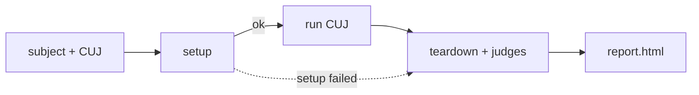

Michelin is an eval harness for AI agents and other programs, driven by LLMs. You describe **critical user journeys (CUJs)** in plain words: what to do and what should be true afterwards. LLMs set the program under test (the **subject**) up, carry out each journey, tear it down, and then a panel of LLM judges scores every expectation against the recorded evidence. Each run leaves `.runs/<runid>/report.html`.

## The parts

- A **subject** is a folder of plain markdown: `setup.md` (start it, print what later steps need), `howtorun.md` (how to talk to it) and `teardown.md` (stop it and delete what it made). It may add `.sh`/`.py` helpers.
- A **CUJ** is a yaml file with `instruction`, `timeout_s`, `expectations`, and an optional `story` (a note for humans). A CUJ that needs a start state seeds it from its instruction (e.g. a first step that runs a seed script setup provides). CUJs live in their subject, `subjects/<name>/cujs/`. Its id is its path under the last `cujs/`, dashed (`toy-country`).
- Four roles, each a `claude -p` call: the **constructor** runs setup, the **executor** carries out the CUJ and records evidence, the **destructor** runs teardown, and the **judges** score each expectation from the evidence alone. The first judge scores alone; the others join, and the majority wins, only when it fails an expectation, gives no valid result, or differs from a baseline verdict (`--baseline <earlier run folder>`). `--all-judges` always runs every judge.
- A CUJ argument may be a folder: every `*.yaml` directly in it runs. Every CUJ gets a fresh start: its own setup, RUNDIR and teardown, in a subfolder of the command's one run folder, `.runs/<runid>/<cuj-id>/`; `michelin compare` takes that run folder per agent. One michelin runs per subject at a time per OS user (`<os temp>/michelin-<user>/run-<subject>.lock`); point every user's `MICHELIN_TMP` at one shared `chmod 1777` folder to hold one lock across users.
- Test subjects for the unit and integration tests are in `test/fixtures/subjects/`.

## Black box by default

Michelin tests the subject from the outside, the way a user sees it. The executor talks to it through `howtorun.md` and records what comes back, and the judges score only that evidence. If you want the runner to collect logs or other internals (white box), write that into your CUJ and your `howtorun.md` yourself. Be careful with what you put in evidence: logs can name the model or the subject, and then a blind compare is no longer blind.

## The must-fail control

Every suite should ship a **must-fail control**: a CUJ the subject handles correctly but whose expectations are deliberately wrong. A healthy judge panel scores it `passed 0/n`. If a control ever passes, the judges are rubber-stamping and the rest of that run can't be trusted.

## Settings

Flags, then `./michelin.json`, then the built-in defaults: every key, flag and environment variable is in [settings.md](settings.md).
